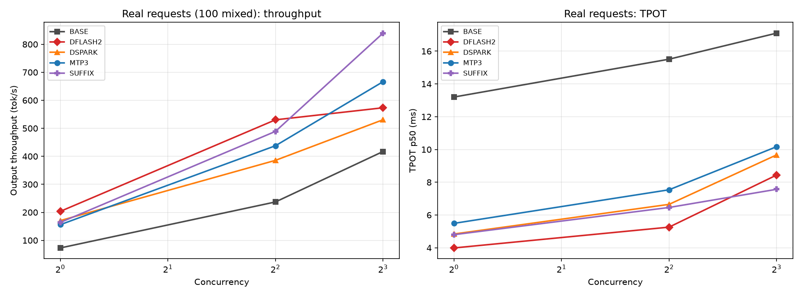
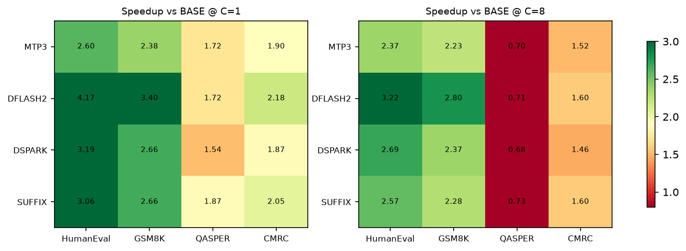

<div align="center">

# 🎯 Qwen3.8-27B × 2× RTX 5090 — speculative decoding, measured

*Five speculative-decoding paths on Qwen3.8-27B-FP8, TP=2 with no NVLink: should you enable it, which one, and when does it make things slower?*


<sub><b>English</b> · <a href="README.zh-CN.md">中文</a></sub>

</div>

This repository is a **complete, reproducible experiment**: the request-set generators, the load-test scripts, raw data for 385 runs, failure logs from the failed runs, two reports, and a **consistency check you can run without a GPU** (`scripts/reproduce_tables.py`).

---

## 🎯 TL;DR

| Question | Answer |
|---|---|
| Fastest at low concurrency | **DFlash2 K=6**: C=1 **203.5 tok/s, 2.79×** BASE, TPOT 3.99 ms |
| Most stable at high concurrency | **MTP3**: C=8 **666.3 tok/s (1.60×)**, and KV capacity only drops to 112k |
| The trap | **SUFFIX**: cold start is just **1.14×**; the "hot cache 2.25×" is repeated requests letting the suffix tree hit its own output from the previous round |
| The cost | KV pool capacity: BASE 207k → MTP3 112k → SUFFIX 102k → DFlash2 58k → DSpark 57k tokens |
| EAGLE-4 | **Both paths fail to run**, with the verbatim errors, and no performance data (no invented numbers) |
| What decides the gain | **Task type**, not K and not the engine: acceptance 0.381–0.828, a **2.17×** spread across tasks |

## 📊 Mixed 100 real requests

*100 mixed real requests · C=1/4/8 · median of 3 repetitions · output tok/s*

| Method | C=1 | C=4 | C=8 | Speedup 1 / 4 / 8 | TPOT C=1 | Acceptance | KV tokens |
|---|---|---|---|---|---|---|---|
| BASE | 72.9 | 237.1 | 417.1 | 1.00 / 1.00 / 1.00 | 13.19 ms | — | 207,209 |
| MTP3 | 156.0 | 437.7 | **666.3** | 2.14 / 1.85 / **1.60** | 5.49 ms | 0.622 | 112,167 |
| **DFLASH2** | **203.5** | **530.3** | 573.3 | **2.79** / **2.24** / 1.37 | **3.99 ms** | 0.568 | 58,391 |
| DSPARK | 170.6 | 385.6 | 530.5 | 2.34 / 1.63 / 1.27 | 4.84 ms | 0.583 | 56,764 |
| SUFFIX (cold start) | 82.9 | — | — | **1.14** | 11.36 ms | 0.311 | 101,693 |
| SUFFIX (median of 3) | 164.0 | 489.0 | 839.7 | 2.25 / 2.06 / 2.01 | 4.80 ms | 0.609 | 101,693 |



> **SUFFIX cache pollution**: when the same request set is load-tested again, the suffix tree caches the previous round's responses, so acceptance goes R1 0.311 → R2 0.609 → R3 0.719 and throughput 82.9 → 164.0 → 195.3 tok/s.
> **The fair number is the R1 cold start (1.14×)**; the median only represents the special case of "repeated traffic".
>
> For C=4 the cold start has one separate extra run (fresh server): **210.4 tok/s, acceptance 0.311, about 0.89× BASE — slower than BASE**.
> In the same phase, `_C04_R01_A`'s 376.0 tok/s does not count as a cold start: it ran on the same instance right after three C=1 rounds, with the cache already warmed up (acceptance already up to 0.659). There is no separate cold-start run at C=8, so it is left blank rather than padded with a warmed-up value.

## 🧩 Per task category

*4 datasets × 64 requests · C=1/4/8/16/32 · 3 repetitions*

| Category | Best method | C=1 speedup | C=8 speedup | C=32 speedup | Acceptance (C=1) |
|---|---|---|---|---|---|
| Code — HumanEval | **DFlash2 K=6** | **4.17×** | 3.22× | 1.34× | **0.837** |
| Math — GSM8K | **DFlash2 K=6** | **3.40×** | 2.80× | 1.14× | 0.621 |
| Long docs — QASPER | **SUFFIX** | **1.87×** | 0.73× | 0.93× | 0.526 |
| Chinese QA — CMRC2018 | **DFlash2 K=6** | **2.18×** | 1.60× | 1.07× | 0.408 |



**Same DFlash2 stack: 4.17× on code, only 1.72× on long docs** — the gap comes from the task itself, not from tuning. Long-document QA is a long-input, short-output workload, and speculation only acts on the decode phase; prefill saves nothing.

## ✅ Three conclusions you can ship

1. 🧭 **Look at the task before you look at speculation.** For short-output / long-input workloads (RAG, long-document QA), do not expect speculative decoding to pay off: on QASPER, from C≥8 upward all four methods are **below BASE** (0.68–0.73×).
2. 📉 **High concurrency eats the gain.** On mixed traffic DFlash2 falls from 2.79× at C=1 to 1.37× at C=8, while MTP3 is in fact the most stable under high concurrency (1.60×). **Pick MTP for throughput, DFlash2 for latency.**
3. 🧾 **KV capacity is the hidden bill.** DFlash2's 2.79× is bought by shrinking the KV pool from 207k to 58k tokens (about 72%), and with high concurrency on long context you hit the capacity wall first.

## ⚠️ What these results do NOT support

Honest boundaries — read these together with the numbers (details in the Limitations section of each report):

- **EAGLE-4 has no performance numbers at all.** The official path reports `Model architectures [...] are not supported`, the harness path reports `CUDA error: invalid argument`. The repository keeps the full failure logs and **did not fill the gap with estimates**.
- **C=16/32 variance is large** (two repetitions of the same configuration can differ by 30–100%); high-concurrency figures should be read as a range, not a point value.
- **SUFFIX cannot be run as a genuine repeated experiment on a fixed request set** (cache effects); there is only 1 cold start.
- **Quality was only weakly validated**: GSM8K 0.80→0.76 is a difference of 1 item out of 25, **no significance test was performed**, so it cannot be used to claim a quality regression; HumanEval only checks syntax, not pass@1.
- **Single machine, single model, single session**; no cross-machine reproduction.
- **JDDC 2.1 was not obtained**; CMRC2018 is used as a substitute and labelled as such.

---

## 📦 Repository layout

```
README.md                    This file: conclusions + boundaries
REPRODUCE.md                 From-scratch reproduction guide (environment, model, data, load test, summary, pitfalls)
docs/
  report-mixed100.md         Report ①: mixed 100 real requests (5 methods × C=1/4/8 × 3 reps)
  report-per-dataset.md      Report ②: per task category (4 categories × 64 requests × C=1..32 × 3 reps)
  report-per-dataset.pdf     PDF version of Report ②
  tp-deployment-2x5090.md    Prerequisite: 2-GPU TP=2 deployment log (bring-up with Qwen3-32B-AWQ)
  environment.txt            Measured environment snapshot (driver / torch / vLLM / topology / weight sizes)
data/
  requests.jsonl             100 mixed requests (4 categories × 25, fixed-seed sampling after dedup)
  requests_per_dataset.jsonl 256 per-category requests (4 categories × 64)
  README.md                  Sources, licenses, replayability check
scripts/
  fetch_datasets.py          Download the 4 public datasets
  build_requests.py          Build the request sets (--n 25 / --n 64)
  run_mixed100.py            Load test: one server per method, N repetitions per concurrency level
  run_per_dataset.py         Load test: grouped by dataset + bottleneck probes (BNB / fp8 KV / EAGLE)
  make_tables.py             Summary tables + concurrency curve figure
  analyze_ds.py              Per-category aggregation (median / speedup / ranking)
  make_figs2.py              Hardware and task-type figures
  make_figs_ds.py            Three per-category figures
  build_excel.py             Build runs_all.xlsx (6 sheets)
  score2.py                  Output-quality scoring (character F1 / numeric accuracy / syntax)
  reproduce_tables.py        ★ No GPU needed: recompute every table from the CSVs and reconcile with the reports
results/
  real_runs.csv              34-field raw data for all 385 runs (phase column for traceability)
  runs_all.xlsx              Summary workbook
  per_dataset_summary.md     Per-category summary
  results_summary.md         Mixed-100 summary
  raw_per_request.tgz        24 per-request JSONL files (TTFT/ITL/output length)
  k-sweep/                   Raw records of the K sweep
  recomputed-tables.md       Recomputed tables produced by reproduce_tables.py
figures/                     6 figures (referenced by the reports)
logs/
  all_logs.tgz               Server logs + verbatim EAGLE-4 failure output
  logs_v3.tgz                Per-category round logs (incl. kv/bnb probes)
  eagle_calibration.tgz      EAGLE-4 width-8 calibration artifacts
  k-sweeps/                  Server logs from the K sweep
```

---

## 🚀 Quick start

**3 minutes, no GPU**: recompute the report tables from the raw CSVs and reconcile them.

```bash
git clone https://github.com/lichen9240-creator/qwen27b-spec-decode-2x5090.git
cd qwen27b-spec-decode-2x5090
python scripts/reproduce_tables.py --check
# → consistency check: 12 items, 0 failures
```

**Full reproduction** (~1 day on the two 5090s): see **[REPRODUCE.md](REPRODUCE.md)**. The shortest path is four steps:

```bash
python scripts/fetch_datasets.py                  # pull the public data
python scripts/build_requests.py --n 25           # build the request sets (byte-identical to the files in this repo)
python scripts/run_mixed100.py --methods BASE,MTP3,DFLASH2,DSPARK,SUFFIX \
       --concurrency 1,4,8 --reps 3 --phase A     # launch servers and load-test
python scripts/make_tables.py && python scripts/reproduce_tables.py --check
```

---

## 🔬 Environment

| Item | Value |
|---|---|
| GPU | 2× RTX 5090 32607 MiB (sm_120), GPU0–GPU1 topology = `SYS` (cross-NUMA, **no P2P / no NVLink**) |
| Driver | 580.105.08 |
| Engine | vLLM 0.32.0 (EAGLE custom build `0.32.0rc1.dev283+eagle.5`) |
| Base stack | torch 2.13.0+cu130, transformers 5.19.0, CUDA 13.0 |
| Model | Qwen3.8-27B-FP8 (29.5 GB, `qwen3_5`, 64 layers / 16 full-attention layers / 1 built-in MTP layer) |
| Draft weights | DFlash2 3.6 GB, DSpark 3.7 GB, EAGLE-4 5.9 GB |
| Serving flags | `--tensor-parallel-size 2 --gpu-memory-utilization 0.9 --max-model-len 8192` |

Full snapshot in [`docs/environment.txt`](docs/environment.txt).

---

## 📚 Data & licenses

The request sets come from HumanEval (MIT), GSM8K (MIT), QASPER (CC BY 4.0) and CMRC2018 (Apache-2.0); only the sampled prompts and reference answers are kept. Sources and licenses are in [`data/README.md`](data/README.md). The raw datasets are not redistributed with this repository — fetch them yourself with `scripts/fetch_datasets.py`.

## 🔗 Related

- **[llm-sizing-calculator](https://github.com/lichen9240-creator/llm-sizing-calculator)** —
  uses these measured points as the performance-regression baseline for a sizing calculator (7 measured points, MAPE 7.3%).
- **[eagle3-qwen3-1.7b-repro](https://github.com/lichen9240-creator/eagle3-qwen3-1.7b-repro)** —
  the full pipeline for training your own EAGLE-3 draft (single 4090, 2.135×).

## 📄 License

[MIT](LICENSE). The experimental data and reports are released under MIT as well; third-party datasets follow their own licenses.
