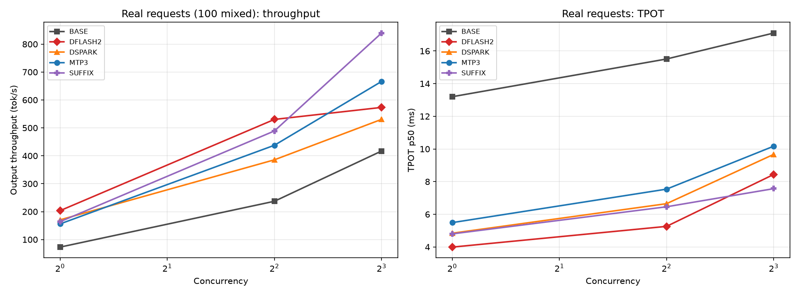
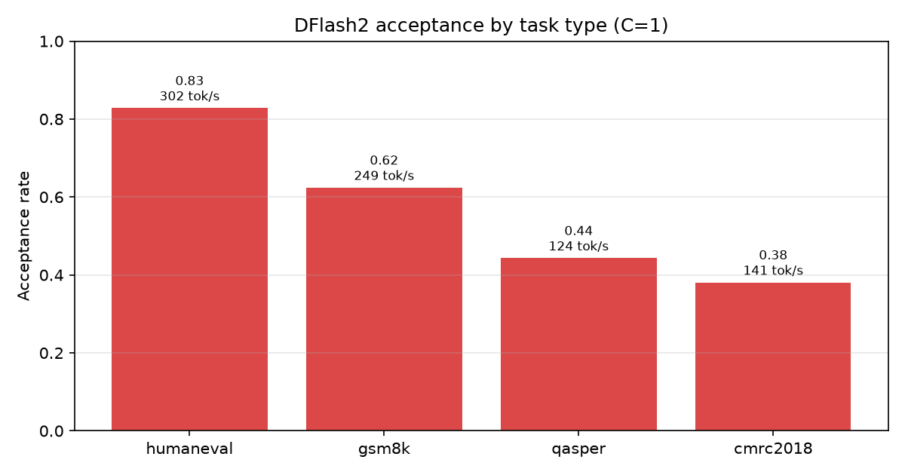
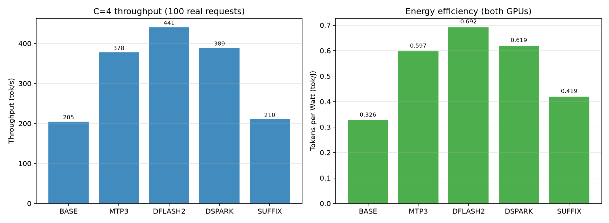

# Qwen3.8-27B 双 RTX 5090 投机解码实验报告

> 2026-10-30 04:31–08:15 ｜ AutoDL 2×RTX 5090（TP=2）｜ vLLM 0.32.0 ｜ 100 条真实请求 × C=1/4/8 × 3 重复

## 一、结论先行

| 问题 | 答案（均有下方数据支撑） |
|---|---|
| 低并发谁最快 | **DFlash2 K=6**：C=1 203.5 tok/s，**2.79×** BASE，TPOT 3.99 ms |
| 高并发谁最稳 | **MTP3**：C=8 666.3 tok/s（1.60×），KV 保留 112k tokens |
| 谁是陷阱 | **SUFFIX**：冷启动仅 1.14×；热缓存 2.25× 是重复请求造成的自我污染 |
| 代价是什么 | KV 容量：BASE 207k → MTP3 112k → SUFFIX 102k → DFlash2 58k → DSpark 57k |
| EAGLE-4 | **两条路径都跑不通**，有原文报错，无性能数据 |
| 瓶颈 | 接受率由**任务类型**决定（0.381~0.828，差 2.17 倍），不由 K 或引擎决定 |

## 二、环境、清理与请求集

| 项 | 值 |
|---|---|
| GPU / 驱动 | 2× RTX 5090 32607 MiB / 580.105.08；GPU0–GPU1 = **SYS**（跨 NUMA，无 P2P） |
| 基础环境 | torch 2.13.0+cu130、vLLM 0.32.0、transformers 5.19.0 |
| EAGLE 环境 | 独立 venv `/root/env/eagle`，vLLM **0.32.0rc1.dev283+eagle.5**（官方 wheel 源） |
| 模型 | Qwen3.8-27B-FP8（29.5GB，fp8 e4m3，`qwen3_5`，64 层 / 16 层 full attention / 内置 1 层 MTP） |
| 草稿权重 | DFlash2 3.6GB、DSpark 3.7GB、EAGLE4 5.9GB |

**磁盘清理**：审计时数据盘 4.6GB（91%）。把 9.4GB conda 环境迁到系统盘（修正 shebang/.pth，`vllm --version` 复验），删旧日志，**释放到 14GB**，才装得下 EAGLE4。

**请求集**（100 条，去重后随机抽样，seed=20261030）：

| 数据集 | 类别 | 许可证 | 条数 | 平均输入字符 |
|---|---|---|---|---|
| HumanEval | 代码生成 | MIT | 25 | 405 |
| GSM8K | 数学推理 | MIT | 25 | 225 |
| QASPER | 长文档问答 | CC BY 4.0 | 25 | 11,691 |
| CMRC2018 | 中文问答（**JDDC 替代**） | Apache-2.0 | 25 | 582 |

**JDDC 2.1 未获取**：HF 四个镜像（XiaoBuL / nlp-jddc / jddc / datawhale）均返回 401，需授权。
按任务书改用可获取的 CMRC2018，类别标注为替代，**不声称已获取 JDDC**。输入不含答案，QASPER 用正文段落非拼接文本。

## 三、方法可用性与 EAGLE-4 的真实限制

| 方法 | 状态 | 关键证据 |
|---|---|---|
| BASE / MTP3 / DFLASH2 / DSPARK | ✅ | 各完成 C=1/4/8 × 3 重复 |
| SUFFIX | ✅（装依赖后） | 首次报 `Arctic Inference is required`，装 `arctic-inference==0.1.1` 后可用 |
| **EAGLE-4 官方路径** | ❌ | `ValueError: Model architectures ['EagleLlamaForCausalLMEagle4'] are not supported` |
| **EAGLE-4 + harness** | ❌ | 校准 width-8 成功、width-16 失败；用 width-8 起服务报 `CUDA error: invalid argument`（换 attention backend 相同） |

**harness 的依赖真相**：`eagle-harness 0.1.4` 在原生 vLLM 0.32.0 上被自检禁用
（`lacks 8 of the hooks it needs`：`register_speculative_method`、`SpeculativeConfig.method_config`、`BaseSpeculator.prepare_verify_inputs` 等）。
装官方定制构建后 `missing_hooks()` 返回 `NONE`，说明**引擎侧已就绪，卡在 GPU 内核执行**。
两条路径的差异不在调度策略，而在能否加载/执行；因此**本次不含任何 EAGLE 性能数字**。

## 四、主结果（3 次重复中位数）

| 方法 | C=1 | C=4 | C=8 | 加速 C=1/4/8 | TPOT C=1 | 接受率 | KV tokens |
|---|---|---|---|---|---|---|---|
| BASE | 72.9 | 237.1 | 417.1 | 1.00 / 1.00 / 1.00 | 13.19 ms | — | 207,209 |
| MTP3 | 156.0 | 437.7 | **666.3** | 2.14 / 1.85 / **1.60** | 5.49 ms | 0.622 | 112,167 |
| **DFLASH2** | **203.5** | **530.3** | 573.3 | **2.79** / **2.24** / 1.37 | **3.99 ms** | 0.568 | 58,391 |
| DSPARK | 170.6 | 385.6 | 530.5 | 2.34 / 1.63 / 1.27 | 4.84 ms | 0.583 | 56,764 |
| SUFFIX **冷启动** | 82.9 | 210.4 † | — | **1.14** / 0.89 † | 11.36 ms | **0.311** | 101,693 |
| SUFFIX 3 次中位数 | 164.0 | 489.0 | 839.7 | 2.25 / 2.06 / 2.01 | 4.80 ms | 0.609 | 101,693 |

> † **C=4 的冷启动只能取 §6 的独立补采**（新起服务、phase HW）：210.4 tok/s、接受率 0.311，
> 约 BASE C=4 的 **0.89×**，比 BASE 还慢。
> 同一相位里 `_C04_R01_A` 的 376.0 tok/s（接受率 0.659）**不是冷启动**——它跑在同一实例的
> C=1 三轮之后，缓存已被预热。本表早先误把这个值写成 1.59×，现已更正；
> 冷启动 C=8 没有独立补采，故留空而不是拿预热值充数。
> 补采只有 1 次且该次 SM 利用率仅 67.7%，**不能与 3 次中位数口径直接比较**，只作方向性证据。



**SUFFIX 的缓存污染**：同一请求集重复压测时后缀树缓存上一轮回复，接受率 R1 0.311 → R2 0.609 → R3 0.719，
吞吐 82.9 → 164.0 → 195.3。**公平值取冷启动 R1（1.14×）**；中位数反映"重复流量"场景。
这也解释了上一轮 filler prompt 实验里 SUFFIX 的 3.0×——那批 prompt 本身就是同一句话重复拼接。

**K 值**：沿用历史扫描结论（MTP K=3、DFlash2 K=6、DSpark K=4）并在真实请求上验证接受率
（0.622 / 0.568 / 0.583），与历史趋势一致。SUFFIX 不用 K（机制为后缀树）。

## 五、长上下文与瓶颈验证

**长上下文**（QASPER 25 条，C=1/4，2 次重复）。原计划对比 EAGLE-4+harness 与 DFlash2，
EAGLE 不可用，改用 BASE/MTP3/DFlash2 对照，结论不外推：

| 方法 | C=1 R1/R2 | C=4 R1/R2 | TTFT C=1 (R1) | 接受率 |
|---|---|---|---|---|
| BASE | 62.0 / 72.3 | 223.9 / 220.2 | 386.9 ms | — |
| MTP3 | 105.5 / 125.1 | 307.6 / 313.8 | 377.5 ms | 0.541 |
| **DFLASH2** | **123.7 / 149.3** | **343.9 / 349.1** | 372.0 ms | **0.443** |

长文档把 TTFT 拉高一个数量级（BASE 70.9 → 386.9 ms），投机收益从 2.79× 降到 **2.07×**（C=1）、1.56×（C=4）——prefill 占比升高，投机只作用于 decode 段。

**瓶颈验证**（DFlash2 K=6、C=1、**每个数据集单次运行**，其余参数不变）。
注意：这是**诊断性探测**，不是「每方法 × 每数据集 × 3 重复」的正式矩阵——只用来回答"同一方法内接受率是否随任务变化"：

| 数据集 | 输入 token | 吞吐 | TTFT | TPOT | **接受率** |
|---|---|---|---|---|---|
| HumanEval | 139 | **302.3** | 61.3 ms | **2.79 ms** | **0.828** |
| GSM8K | 71 | 249.4 | 60.9 ms | 3.50 ms | 0.624 |
| QASPER | 2,483 | 123.9 | 370.0 ms | 5.11 ms | 0.443 |
| CMRC2018 | 406 | 141.3 | 85.0 ms | 4.80 ms | **0.381** |



接受率跨任务 **2.17 倍**（0.381–0.828），吞吐 2.44 倍。**已被直接验证**：同一方法内，投机收益强依赖任务分布，
不能用单一接受率代表所有场景；容量规划须按业务任务配比加权。

**这一节不能支持什么**：因为没有其他方法的分数据集数据、也没有重复，**无法给出分数据集的方法排名**（例如"DFlash2 在代码任务上比 MTP3 快多少"），
也无法给出分数据集的方差。主表（§4）的 3 次重复只针对**混合 100 条**这一种流量。
**未验证因果**：中文问答为何最低（词表/训练分布），本次只有相关性证据。

## 六、硬件与质量

| 方法（C=4） | 吞吐 | SM 利用率 卡0/卡1 | 功耗 W | 显存/卡 | **每瓦 token** |
|---|---|---|---|---|---|
| BASE | 204.7 | 93.9 / 94.9 | 306/321 | 28.76 | 0.326 |
| MTP3 | 377.7 | 90.6 / 91.3 | 310/323 | 28.92 | 0.597 |
| **DFLASH2** | **440.6** | 90.1 / 87.3 | 311/326 | 29.18 | **0.692** |
| DSPARK | 388.9 | 88.7 / 91.0 | 308/321 | 29.03 | 0.619 |
| SUFFIX（冷） | 210.4 | 67.7 / 71.1 | 245/258 | 29.10 | 0.419 |



DFlash2 吞吐 2.15×、每瓦 token 2.12×，同比例提升说明没有额外能效损耗。两卡 SM 利用率差 ≤3.6 个百分点、
显存完全相同（TP 切分正常）——但**这只是利用率接近，不能据此断言计算负载均衡**（需逐卡 kernel 计时）。

**缺失指标**：显存带宽利用率**不可用**（`utilization.memory` 是占用时间比例，不是 HBM GB/s，未接 DCGM）；
请求排队只能由 TTFT p95 间接反映。SM 利用率、显存、功耗、温度、频率均为实测。

**输出质量**（max_tokens=512，Track B）：

| 方法 | 吞吐 | GSM8K 数值准确率 | HumanEval 语法 | QASPER F1 | CMRC 字符 F1 |
|---|---|---|---|---|---|
| BASE | 72.0 | 0.800 | 1.000 | 0.105 | 0.229 |
| MTP3 | 158.4 | 0.800 | 1.000 | 0.103 | 0.219 |
| DFLASH2 | **213.0** | 0.760 | 1.000 | 0.103 | 0.214 |

DFlash2 在长输出下达 **2.96×**（512 token 摊薄 TTFT）。GSM8K 0.80→0.76 是 25 条里 1 条之差，
**未做显著性检验，不能断言质量退化**；HumanEval 仅语法检查，非 pass@1。

## 七、局限（必须随结论引用）

1. **EAGLE-4 无数据**：两条路径均失败，长上下文对照被替代为 BASE/MTP3/DFlash2。
2. **C=16/32 未测**：预算优先保 C=1/4/8 的 3 次重复。
3. **主矩阵显存 22/27 行缺失**：采样器 `nvidia-smi -l 1` 管道缓冲所致，已改为每秒独立采样并在 C=4 补采（§6 数据完整）。
4. **SUFFIX 只有 1 次冷启动**：缓存使其无法在"同一请求集"上做真正的重复实验，需换请求集才能测 3 次。
5. **JDDC 未获取**：用 CMRC2018 替代并标注。
6. **按数据集的正式矩阵缺失**：只有 DFLASH2 / C=1 / 单次 的四组探测（25 条/组），
   没有「每方法 × 每数据集 × 3 重复」的数据；因此不能给分数据集的方法排名，也没有分数据集方差。
   本节结论仅在"混合流量"口径下适用于方法对比。
   > 该缺项已在后续一轮补齐：见 **[report-per-dataset.md](report-per-dataset.md)**
   > （4 数据集 × 5 方法 × C=1/4/8/16/32 × 3 重复，共 300 次运行）。
7. 单机单模型单次会话，未做跨机复现；未做 C=16 以上的容量边界探测。

## 八、复现

在仓库根目录执行（细节见 [REPRODUCE.md](../REPRODUCE.md)）：

```bash
# 环境：vLLM 0.32.0 + torch 2.13.0+cu130（版本清单见 docs/environment.txt）

# 1) 取公开数据并生成 100 条请求集（与仓库内 data/requests.jsonl 逐字节一致）
python scripts/fetch_datasets.py
python scripts/build_requests.py --n 25

# 2) 跑混合 100 条矩阵：每个方法起一次服务，C=1/4/8 各 3 次重复
export BENCH_ROOT=/root/bench     # 日志/指标/结果写到哪里；默认写仓库根目录
python scripts/run_mixed100.py \
  --methods BASE,MTP3,DFLASH2,DSPARK,SUFFIX --concurrency 1,4,8 --reps 3 --phase A

# 3) 汇总表与图；或离线只重算表并校验（不需要 GPU）
python scripts/make_tables.py
python scripts/reproduce_tables.py --check
```

产物：`results/real_runs.csv`（含本轮的 45 次混合 100 条运行，工作簿见 `results/runs_all.xlsx`）、
`results/raw_per_request.tgz`（24 个逐请求 JSONL）、`logs/all_logs.tgz`（含 EAGLE 失败原文与服务日志）、
`logs/eagle_calibration.tgz`（width-8 校准产物）、`docs/environment.txt`（环境快照）。
