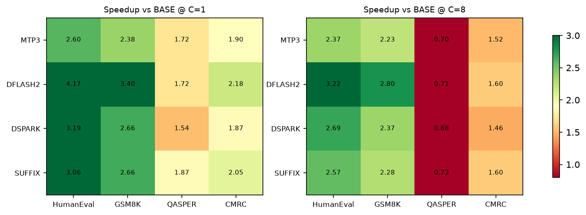
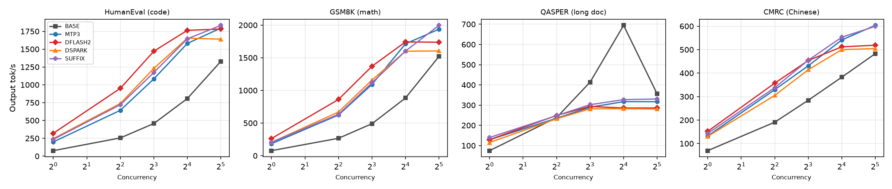
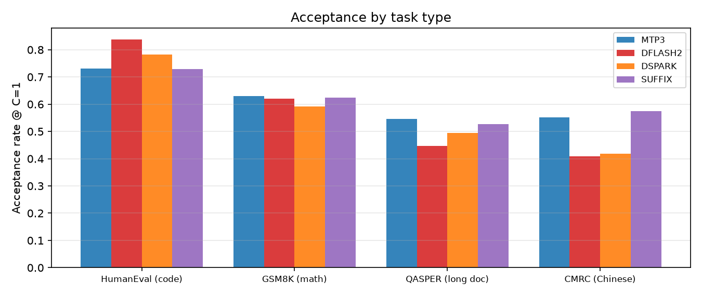

# 按任务类别的投机解码对比实验（Qwen3.8-27B / 双 RTX 5090）

> 2026-10-31 06:05–09:00 ｜ TP=2 ｜ vLLM 0.32.0 ｜ **4 类 × 64 条 = 256 请求 × 5 方法 × C=1/4/8/16/32 × 3 重复 = 300 次运行**

## 一、结论先行

| 任务类别 | 最优方法 | C=1 加速 | C=8 加速 | C=32 加速 | 接受率 (C=1) |
|---|---|---|---|---|---|
| **代码** HumanEval | **DFlash2 K=6** | **4.17×** | 3.22× | 1.34× | **0.837** |
| **数学** GSM8K | **DFlash2 K=6** | **3.40×** | 2.80× | 1.14× | 0.621 |
| **长文档** QASPER | **SUFFIX** | **1.87×** | 0.73× | 0.93× | 0.526 |
| **中文问答** CMRC2018 | **DFlash2 K=6** | **2.18×** | 1.60× | 1.07× | 0.408 |

三条可直接用的结论：

1. **投机解码的收益由任务类型决定，不是引擎**：同一 DFlash2，代码任务 4.17×、长文档只有 1.72×（C=1），
   接受率 0.837 vs 0.446——**相差近一倍**。
2. **长文档 + 高并发时，投机是净损失**：C≥8 起四种方法全部低于 BASE（0.68–0.73×），
   而 BASE 自己在 C=32 也从 694 掉到 356 tok/s。**这个塌陷与投机无关**，见 §5。
3. **短任务（代码/数学/中文短问答）在 C=32 仍有 1.07–1.38×**，是高并发场景唯一还能用的档位；
   但最优方法会从 DFlash2 切换到 SUFFIX（代码 C=32：SUFFIX 1.38× > DFlash2 1.34×）。

## 二、实验设置

| 项 | 值 |
|---|---|
| 模型 / 引擎 | Qwen3.8-27B-FP8（29.5GB）、vLLM 0.32.0、torch 2.13.0+cu130 |
| 硬件 | 2×RTX 5090 32607 MiB，驱动 595.71.05，GPU0–GPU1 = SYS（跨 NUMA） |
| 方法 | BASE、MTP K=3、DFlash2 K=6、DSpark K=4、SUFFIX（K=4） |
| 请求集 | HumanEval / GSM8K / QASPER / CMRC2018 **各 64 条**，去重后随机抽样（seed=20261030），不含答案 |
| 并发 | C=1 / 4 / 8 / 16 / 32 |
| 重复 | 每格 3 次，取中位数；每轮前强制清理显存（<300 MiB 才开始） |
| 指标 | 输出 tok/s、TTFT/TPOT/ITL 分位、接受率（/metrics 差分）、KV 容量、双卡 SM/显存/功耗 |

EAGLE-4 两条路径沿用上一轮结论（官方路径架构不被接受、harness 报 CUDA error），本轮未重复尝试。

## 三、按类别结果（tok/s，括号为相对 BASE 加速比）

### 代码生成（HumanEval，64 条，平均输入 139 token）

| 方法 | C=1 | C=4 | C=8 | C=16 | C=32 | 接受率 |
|---|---|---|---|---|---|---|
| BASE | 77 | 255 | 457 | 808 | 1329 | — |
| MTP3 | 199 (2.60×) | 642 (2.52×) | 1083 (2.37×) | 1580 (1.96×) | 1796 (1.35×) | 0.731 |
| **DFLASH2** | **320 (4.17×)** | **950 (3.73×)** | **1471 (3.22×)** | **1764 (2.18×)** | 1782 (1.34×) | **0.837** |
| DSPARK | 245 (3.19×) | 738 (2.89×) | 1231 (2.69×) | 1654 (2.05×) | 1641 (1.23×) | 0.782 |
| SUFFIX | 235 (3.06×) | 721 (2.83×) | 1172 (2.56×) | 1644 (2.03×) | **1834 (1.38×)** | 0.729 |

### 数学推理（GSM8K，64 条，平均输入 71 token）

| 方法 | C=1 | C=4 | C=8 | C=16 | C=32 | 接受率 |
|---|---|---|---|---|---|---|
| BASE | 77 | 266 | 490 | 883 | 1520 | — |
| MTP3 | 183 (2.38×) | 623 (2.34×) | 1091 (2.23×) | 1713 (1.94×) | 1938 (1.28×) | 0.629 |
| **DFLASH2** | **262 (3.40×)** | **861 (3.24×)** | **1370 (2.80×)** | **1742 (1.97×)** | 1737 (1.14×) | 0.621 |
| DSPARK | 205 (2.66×) | 668 (2.51×) | 1158 (2.36×) | 1600 (1.81×) | 1604 (1.06×) | 0.591 |
| SUFFIX | 205 (2.66×) | 633 (2.38×) | 1116 (2.28×) | 1602 (1.81×) | **1996 (1.31×)** | 0.624 |

### 长文档问答（QASPER，64 条，平均输入 2,483 token）

| 方法 | C=1 | C=4 | C=8 | C=16 | C=32 | 接受率 |
|---|---|---|---|---|---|---|
| BASE | 75 | 238 | 414 | **694** | 356 | — |
| MTP3 | 129 (1.72×) | 235 (0.99×) | 290 (0.70×) | 317 (0.46×) | 317 (0.89×) | 0.546 |
| DFLASH2 | 129 (1.72×) | 249 (1.05×) | 293 (0.71×) | 286 (0.41×) | 286 (0.80×) | 0.446 |
| DSPARK | 115 (1.53×) | 233 (0.98×) | 282 (0.68×) | 282 (0.41×) | 281 (0.79×) | 0.494 |
| **SUFFIX** | **140 (1.87×)** | **248 (1.04×)** | **302 (0.73×)** | 327 (0.47×) | **330 (0.93×)** | 0.526 |

### 中文问答（CMRC2018，64 条，平均输入 406 token）

| 方法 | C=1 | C=4 | C=8 | C=16 | C=32 | 接受率 |
|---|---|---|---|---|---|---|
| BASE | 70 | 191 | 284 | 383 | 483 | — |
| MTP3 | 132 (1.89×) | 329 (1.72×) | 431 (1.52×) | 541 (1.41×) | 603 (1.25×) | 0.552 |
| **DFLASH2** | **152 (2.17×)** | **357 (1.87×)** | **454 (1.60×)** | 512 (1.34×) | 519 (1.07×) | 0.408 |
| DSPARK | 130 (1.86×) | 305 (1.60×) | 414 (1.46×) | 500 (1.31×) | 505 (1.05×) | 0.419 |
| SUFFIX | 143 (2.04×) | 338 (1.77×) | 455 (1.60×) | **553 (1.44×)** | **599 (1.24×)** | 0.575 |





## 四、发现 1：任务类型是收益的第一解释变量

| 指标 | 代码 | 数学 | 长文档 | 中文 |
|---|---|---|---|---|
| DFlash2 加速 (C=1) | **4.17×** | 3.40× | 1.72× | 2.17× |
| DFlash2 接受率 (C=1) | **0.837** | 0.621 | 0.446 | 0.408 |
| 平均输入 token | 139 | 71 | **2,483** | 406 |
| 输出/输入比 | 高（生成代码体） | 中 | **低（短答案）** | 低 |

代码任务收益最高的原因：输出高度模板化（缩进、关键字、括号），草稿模型逐 token 命中率极高（0.837）；
长文档任务输入 2500 token 但输出只有 128 token，**投机只作用于 decode 段，prefill 完全不受益**，
摊薄后整体加速自然低。

**这句话可以直接用于选型**：先看你的任务是不是"长输入短输出"——如果是，不要期待投机解码。

## 五、发现 2：长文档高并发塌陷，与投机无关


**现象**：QASPER 上 BASE 从 C=16 的 694 tok/s 掉到 C=32 的 356（−49%），投机方法从 C=8 起就平在 280–330，
全部低于 BASE（0.68–0.73×）。TTFT 同步爆炸：DFLASH2 在 C=32 的 TTFT p50 达 **9.5 秒**。

**为什么不是 KV**：BASE 的 KV 池有 222,147 token，32 条 × 2,483 token 只需 **79k（35%）**，远未打满；
但 BASE 仍腰斩。**为什么不是投机开销**：BASE 自己就塌了。

**结论（有数据支持，未做因果分离）**：长 prompt × 高并发时，瓶颈是 **prefill 排队与长上下文注意力成本**，
不是 KV 容量、也不是投机引入的开销。证据是 TTFT 从 389 ms 涨到 9.5 s（24 倍），而 TPOT 只从 19.7 ms 涨到 32 ms（1.6 倍）。

## 六、验证实验：KV 与 prefill 分块，哪个是瓶颈？

针对发现 2 设计两组单因子对照（QASPER，C=32，2 次重复）：

| 配置 | 吞吐 tok/s | TTFT p50 | 结论 |
|---|---|---|---|
| BASE 默认 | 411（475 / 347） | 1434 / 2299 ms | 基线 |
| BASE + `max_num_batched_tokens=4096` | 350 | 2716 / 3677 ms | 更差 |
| BASE + `max_num_batched_tokens=8192` | 350 | 4979 / 4065 ms | 无改善 |
| DFLASH2 默认 | 274 | 9542 / 9858 ms | 基线 |
| DFLASH2 + `max_num_batched_tokens=8192` | 298 | 8894 / 8819 ms | +9%，在噪声内 |
| BASE + `--kv-cache-dtype fp8` | **启动失败** | — | FlashInfer 报 `requires GPUs with sm75 or higher` |

**结论**：

- **KV 容量假设不成立**：BASE 的 KV 只用了 35% 仍塌陷；fp8 KV 因环境不支持无法直接验证，但 KV 解释已被 BASE 的反例否掉。
- **prefill 分块也不是主因**：把 `max_num_batched_tokens` 从默认提到 8192，BASE 反而略降（411→350，两次重复 475/347 本身波动 ±30%），
  DFLASH2 提升 9%（274→298），都在噪声范围内。
- **剩下的解释**：长上下文的 attention 计算量与并发调度本身。这一条**只有相关性证据，未做进一步因果分离**（时间与显存限制）。
- 另外得到一个可操作的工程结论：**在 TTFT 已达秒级的区间，调这些参数没有意义**，应当降并发或缩短上下文。

## 七、与上一轮"混合 100 条"口径的对照

| 方法 | 混合 100 条 C=1 | 四类均值 C=1 | 混合 C=8 | 四类均值 C=8 |
|---|---|---|---|---|
| MTP3 | 2.14× | 2.15× | 1.60× | 1.71× |
| DFLASH2 | 2.79× | **2.87×** | 1.37× | **2.08×** |
| DSPARK | 2.34× | 2.31× | 1.27× | 1.80× |
| SUFFIX | 2.25× | 2.41× | 2.01× | 1.79× |

**混合口径会平均掉类别差异**：DFLASH2 在混合口径是 2.79×，四类均值 2.87×，但实际区间是 **1.72×（长文档）到 4.17×（代码）**。
只报混合数字，既高估了长文档场景，也低估了代码场景。

## 八、局限

1. **EAGLE-4 仍无数据**（沿用上轮：官方路径架构不被接受，harness 报 CUDA error）。
2. **fp8 KV 验证未完成**：环境不支持，KV 假设只能靠 BASE 的反例间接否掉。
3. **C=16/32 方差大**：同一配置两次重复可差 30–100%（如 BASE C=16 279 vs 683），报告取 3 次中位数，但高并发结论应视为区间而非点值。
4. **SUFFIX 有缓存效应**：64 条固定请求重复 3 次，R2/R3 接受率会被后缀树缓存抬高（C=1 时 R1 冷启动值最低）。
5. 每类 64 条来自公开集抽样，不代表业务真实分布；JDDC 未获取（沿用 CMRC2018 替代）。
6. 未做质量评分（本轮为纯性能实验，输出质量见上一轮 512-token pass）。

## 九、产物与复现

- **Excel 汇总**：`results/runs_all.xlsx`（385 行原始 + 6 个 sheet：runs_all / per_dataset / mixed / hardware / comparison / README）
- 分类别汇总：`results/per_dataset_summary.md`；原始 CSV：`results/real_runs.csv`（含本轮 300 次运行）
- 图：`figures/fig_ds_speedup_heatmap.png`、`fig_ds_curves.png`、`fig_ds_acceptance.png`
- 日志：`logs/logs_v3.tgz`（matrix_v2b / kv_verify / bnb_verify / 各方法 `*_server.log`）

```bash
# 请求集：本轮的 256 条就是 data/requests_per_dataset.jsonl
# （同一脚本、同一 seed 生成，且每类前 25 条与 data/requests.jsonl 逐条一致，
#   见 data/README.md 的说明）
export REQUESTS_JSONL=$PWD/data/requests_per_dataset.jsonl
export BENCH_ROOT=/root/bench

# 主矩阵：4 数据集 × 5 方法 × C=1/4/8/16/32 × 3 重复 = 300 次运行
python scripts/run_per_dataset.py --methods BASE,MTP3,DFLASH2,DSPARK,SUFFIX \
  --datasets humaneval,gsm8k,qasper,cmrc2018 \
  --concurrency 1,4,8,16,32 --reps 3 --phase DS --limit 300

# 瓶颈验证（QASPER、C=32、2 次重复）
python scripts/run_per_dataset.py --methods BASE,BASE_BNB4K,BASE_BNB8K,DFLASH2_BNB8K \
  --datasets qasper --concurrency 32 --reps 2 --phase BNB --limit 300
python scripts/run_per_dataset.py --methods BASE_FP8KV,DFLASH2_FP8KV \
  --datasets qasper --concurrency 32 --reps 2 --phase KV --limit 300
```

> `--limit` 必须显式给到请求集条数（默认 100 会截断）。`run_quality.py` 是执行当时在机器上的
> 脚本名，本仓库统一为 `scripts/run_per_dataset.py`，评估逻辑与参数一致。
